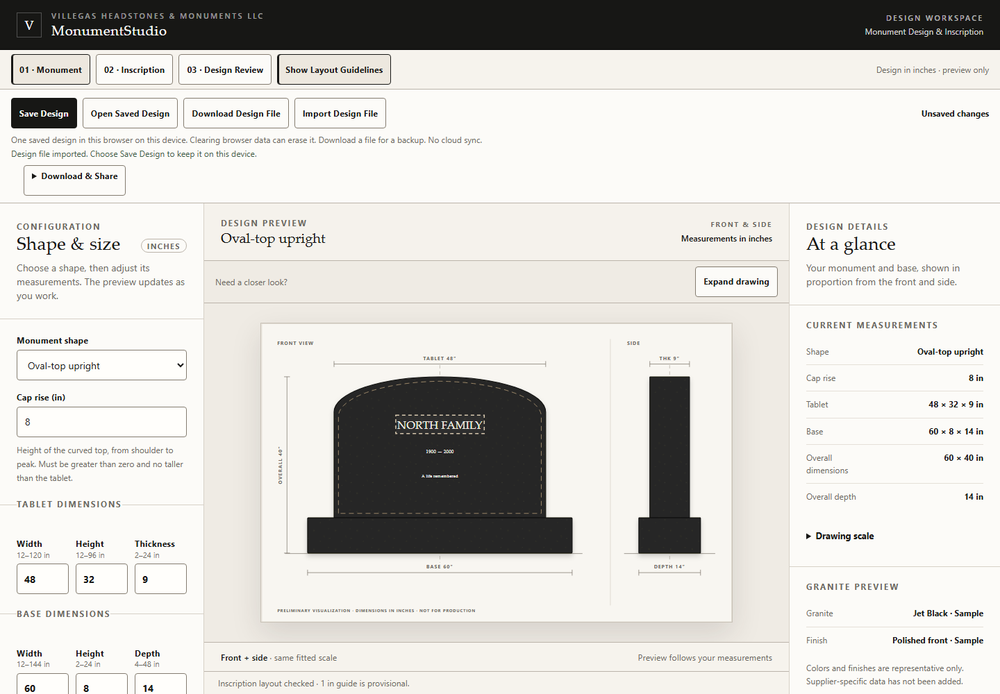
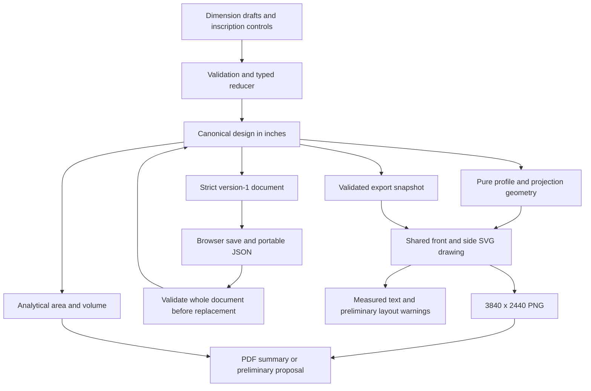

# MonumentStudio

A 2D memorial designer that connects real-world measurements, editable inscriptions, preliminary geometric quantities, and downloadable design documents.



A memorial consultation requires shape, dimensions, lettering, and material
quantities to stay consistent as a design changes. MonumentStudio explores
that practical need identified through **Villegas Headstones & Monuments LLC**.
It is a working engineering prototype; customer adoption and business savings
have not been measured.

[Engineering methods](docs/ENGINEERING_METHODS.md) ·
[One-minute case study](docs/PORTFOLIO_CASE_STUDY.md) ·
[Sample PNG](output/images/sprint-e-design.png) ·
[Design PDF](output/pdf/sprint-e-design-summary.pdf) ·
[Fictional proposal](output/pdf/sprint-e-customer-proposal.pdf)

**Demonstration:** [watch the captioned walkthrough](docs/videos/sprint-e-workflow.mp4)
or run locally using the instructions below. A public URL and hosted CI result
do not yet exist. [Release readiness](docs/RELEASE_READINESS.md)
separates completed local work from owner decisions and remaining evidence.

## The design workflow

1. Choose a **straight-top or oval-top upright**. Enter tablet width, height,
   thickness, base dimensions, and oval cap rise in inches. The front and side
   elevations share a scale; **Expand drawing** provides a closer inspection.
2. Edit the name, dates, and optional epitaph. Center or reposition each line
   with buttons, arrow keys, or precise inch-based controls.
3. Review shape-aware text-boundary and overlap warnings, face area, and nominal
   tablet/base volumes. The guide is preliminary; volume is not weight.
4. **Save Design**, refresh, then **Open Saved Design**. Download and reimport
   a validated design file for a portable editable backup.
5. Open **Download & Share** for a **3840 × 2440 PNG**, searchable PDF summary,
   or preliminary proposal. Proposal notes are optional and clear on closing;
   they appear in the PDF but never enter the saved design.

There is one explicit browser-local save, scoped to the browser profile and
website origin, including its port. There is no autosave, account, cloud sync,
or encrypted customer-record system. Clearing browser data can erase the save.
Output generation runs on the device. Downloads contain entered wording;
“download started” does not prove that a file was retained.

## Engineering approach

**Physical dimensions are authoritative.** Pure TypeScript functions construct
geometry and calculate quantities independently of React and SVG. Invalid
numeric drafts preserve the last valid preview. Resizing or enlarging the
drawing does not change the design.

For each elevation, the fit is `s = min(available width / physical width,
available height / physical height)`. Both elevations use the smaller fit.
A point maps as `screen point = drawing origin + s × inch point`. The tablet
is centered on the base in both projections.

For tablet width `W`, total height `H`, thickness `T`, and oval cap rise `R`:

```text
Straight face: A = WH
Oval face:     A = W(H − R) + πWR/4, with 0 < R ≤ H
Tablet volume: V = AT
Base volume:   Vb = Wb Hb Db
Total volume:  Vtotal = V + Vb
Cubic feet:    Vft³ = Vin³ / 1728
```

The oval combines a rectangle and half an ellipse. Both profiles are solid,
constant-thickness extrusions on a rectangular base. Carving, bevels, holes,
joints, defects, fabrication allowances, and density are outside this model.

**Inscription placement uses inches, too.** Each line stores its horizontal
center and vertical baseline relative to the tablet's upper-left bounding
corner. Actual SVG text bounds are measured in those local units, then checked
against the convex face and other lines. The one-inch layout guide is a
conservative square clearance, not a verified engraving offset. Font size is
an em-square size, not manufactured letter height; browser metrics can vary.

### Architecture



Version-1 documents store profile/rise, dimensions, text, anchors, and font
sizes. They exclude invalid drafts, viewport pixels, text measurements, and
calculated quantities. A complete validated load replaces state atomically
and recalculates derived data; malformed or unsupported files preserve the
current work. Imports are limited to 64 KiB. Cross-tab save checks are best
effort because browser storage has no transactional compare-and-swap.

Exports reuse the geometry, quantity functions, drawing, and inscription glyphs.
A detached snapshot prevents mixed revisions. Fresh text measurement blocks
outside-face/unmeasurable lettering and cropped labels; unfinished numeric
edits also block output. A `960 × 610` logical drawing becomes the PNG at four
pixels per unit. PDFs preserve that ratio at `720 × 457.5 pt`; they are not
calibrated production drawings. Document prose is searchable; the drawing is
rasterized. No external document-generation service is used.

[Architecture details](docs/architecture.md) ·
[Persistence contract](docs/PERSISTENCE_SCHEMA.md) ·
[Export architecture](docs/EXPORT_ARCHITECTURE.md) ·
[Technical explanation](docs/TECHNICAL_EXPLANATION.md)

## Reproduce the geometry

Import [oval-memorial.design.json](examples/oval-memorial.design.json). It uses
fictional wording, a `48 × 30 × 8 in` oval tablet with `8 in` cap rise, and a
`60 × 8 × 14 in` base.

| Quantity | Independent analytical reference |
| --- | ---: |
| Tablet face area | 1357.592895 in² |
| Tablet volume | 10860.743158 in³ |
| Base volume | 6720 in³ |
| Total volume | 17580.743158 in³ / 10.174041 ft³ |

The exact total is `15168 + 768π in³`. Only displayed values are rounded.

## Run and verify locally

Use Node.js **24.16.0** and npm **11.15.0**, the pinned verification environment.
From the directory containing `package.json`:

```bash
npm ci
npm run dev
```

Open [http://localhost:3000](http://localhost:3000). No service accounts or
environment secrets are required. For a production preview, run
`npm run build`, then `npm start`.

```bash
npm run lint
npm run typecheck
npm test
npm run build
npx playwright install chromium firefox webkit
npm run test:e2e
node scripts/check-doc-links.mjs
npm audit --omit=dev
npm audit
```

Browser tests start the production build on port **3100**, which must be free.
On Linux, install browser system libraries with
`npx playwright install --with-deps chromium firefox webkit`.
Ordinary reports, traces, and downloads are ignored test artifacts.

**Verified locally October 18, 2026:** lint, strict types, 185 unit tests in
16 files, and the production build passed. The production browser suite passed
118 cases across Chromium, Firefox, and WebKit, with two intentional
screenshot-only skips and no failures or flaky results. An isolated clean-install
copy also passed lint, types, all 185 unit tests, and the production build.
The production dependency audit reported zero findings; the full audit retained
five high-severity development-package findings from one unpatched advisory.
See the [validation record](docs/VALIDATION.md) and
[dependency review](docs/DEPENDENCY_SECURITY.md) for methods and limitations.

Tests use independent geometry references, reducer and serialization checks,
real browser text measurements, save/restore/import recovery, decoded PNGs,
and independently parsed PDFs. Automated keyboard and axe checks have limited
scope. They do not establish full WCAG compliance, spoken screen-reader
compatibility, human usability, or manufacturing approval. The
[consultant trial](docs/USABILITY_TEST_PLAN.md) is ready to run; human results
remain pending. [GitHub Actions](.github/workflows/verification.yml) is prepared;
local validation is not a successful hosted run.

## Assumptions and limits

- Two upright profiles, one rectangular base, and three single-line,
  unrotated inscriptions are supported. Numeric limits are prototype guards,
  not verified supplier inventory or fabrication constraints.
- No weight, stress, stability, cemetery, lifting, installation, or
  manufacturing approval follows from nominal volume or text warnings.
- PDF prose supports checked Latin, Greek, Cyrillic, and common glyphs in the
  bundled font. Unsupported scripts, combining marks, and emoji fail explicitly
  without changing canonical wording. JSON preserves the entered text.
- PDFs are untagged; PDF/UA compliance, a spoken screen-reader/PDF-reader
  review, and physical printing are not established. Physical touch-device
  testing and a real consultation trial remain pending.
- Proposals are preliminary, with no pricing, contract, or approval workflow.
  There is no customer database, authentication, undo/redo, dragging, or 3D.

Next evidence priorities are human consultation, assistive-technology review,
physical print inspection, and resolution or disclosure of dependency findings.
Possible later work includes 3D visualization and a separately scoped commercial
workflow; neither is implemented or implied by this release preparation.

## My Contribution

I directed the product requirements, supplied monument-industry context, and
defined the portfolio goals. The project connects memorial-design consultation
needs with parametric geometry, inscription editing, and reviewable outputs.

The portfolio theme is **“Applying mathematics and computation to design and
improve physical systems.”** The [case study](docs/PORTFOLIO_CASE_STUDY.md) and
[demonstration script](docs/DEMO_SCRIPT.md) connect that theme to observable work.
The [earlier workflow recording](docs/videos/sprint-c-workflow.webm) documents
editing and persistence; it does not demonstrate the PDF/proposal features.

## Rights and publication

MonumentStudio's original software and associated documentation are licensed
under the [MIT License](LICENSE), with **Copyright (c) 2026 Matthew Villegas**.
Retain the copyright and permission notice when redistributing copies or
substantial portions of the software. Third-party components retain their own
licenses; preserve the [third-party notices](public/THIRD_PARTY_NOTICES.txt).

The software license does not grant trademark rights in the **Villegas Headstones
& Monuments LLC** name, logos, or branding, or imply company endorsement.
Approval to publish company branding and other supplied assets remains a separate
owner-review item. Repository visibility and external publication are also
separate decisions; a public demo exposes its browser-delivered code and assets.

The drawing uses code-generated geometry and system-serif lettering; no system
font binary is redistributed. PDF prose embeds unmodified Noto Sans with its
included SIL Open Font License and [attribution](public/fonts/README.md).
The project MIT decision does not replace those third-party terms. The
[license inventory](docs/THIRD_PARTY_LICENSES.md) records the reviewed dependency
versions and distribution boundaries.

[Publication checklist](docs/PUBLICATION_CHECKLIST.md) compares public source
with a public demo and restricted source disclosure. No commit, remote, push,
deployment, public release, or hosted CI success is implied by local preparation.
